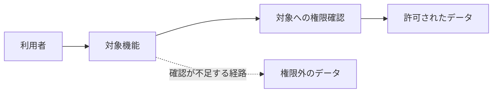

# Issue 本文の書式

日本語で、対象機能を初めて読む人にも前提と判断理由が分かるように書く。以下の欄を実際の調査結果に置き換え、該当しない欄はその理由を示す。図のラベルは短くし、コードや Issue 本文から取り出した文字列をそのまま Mermaid の構文に埋め込まない。

## 個別 Issue

タイトルは `[high] 別組織のデータを取得できる` のように、`severity.impact.score` をそのまま接頭辞に使い、問題を具体的に書く。`fingerprint-alias` は必要な数だけ行を作り、未登録なら省く。確認できない `completed-at` も省く。

````markdown
<!-- security-audit:begin -->
<!-- security-audit:fingerprint=<最初に登録した fingerprint> -->
<!-- security-audit:fingerprint-alias=<同じ根本原因の別 fingerprint> -->
<!-- security-audit:source-sha=<監査対象の完全なコミット SHA> -->
<!-- security-audit:completed-at=<確認済みの報告確定日時（オフセット付き ISO 8601）> -->
## 対象機能と守るべきルール

機能の目的、利用者と対象データの関係、本来必要な権限確認を説明する。

## 問題と影響

誰が、どの条件で、どの権限の境界を越え、何をできてしまうかを説明する。
タイトルの影響評価と Cloudflare の総合深刻度を示し、確認した影響と成立条件を根拠に説明する。

## 処理の流れと根本原因

正常な経路と問題の経路を文章と図で説明する。次の図は実際の機能に合わせて書き換える。



## コード上の根拠

監査対象コミットに固定したコードリンクと、各箇所が問題にどう関係するかを書く。
独立検証で確認した事実と、検証に使ったダミーデータなどの前提を説明する。

## 修正方針

守るべき条件をどこで強制するか、最小限の修正方針を書く。

## 修正完了条件

- 許可される操作と拒否される操作を確認できること。
- 問題の経路を対象にした回帰テストなどで修正を確認できること。
<!-- security-audit:end -->
````

## 集約 Issue

タイトルは `[yyyy-mm-dd] セキュリティ監査の調査・判定一覧` とし、実行時に記録したタイムゾーンの日付を使う。日時・版番号・反映結果は [集約 Issue の手順](issue-sync.md#6-集約-issue-に反映する) に従う。

同じ根本原因の項目を1行にまとめる。各行の ID は fingerprint とし、未割り当ての候補には元スキルの台帳と対応する安定した項目 ID を付ける。各表が0件なら0件と書き、未確認なら不明と書く。各行は冒頭の監査対象 SHA・報告確定日時に対応させ、異なる根拠を参照する場合はその行に明記する。

```markdown
<!-- security-audit:summary-begin -->
<!-- security-audit:summary-id=<実行固有の audit_id> -->
<!-- security-audit:summary-revision=<保存した版番号> -->
<!-- security-audit:source-sha=<監査対象の完全なコミット SHA> -->
監査対象のリポジトリ・コミット、プロファイル、監査範囲を書く。
監査の完了状況、Issue 反映の状況、実行のタイムゾーンとオフセット付き報告確定日時、タイトルの日付の出所を書く。
確定・要検証・未検証・棄却の件数を示す。

## 確定

| ID | 影響評価 | 問題と影響の概要 | 個別 Issue | 反映結果・残る対応 |
| --- | --- | --- | --- | --- |
| fingerprint | high | 前提と確認した影響 | 個別 Issue のリンク | 作成・更新・変更なし・保留と、その理由やラベルの結果 |

## 要検証

| ID | 仮説と想定される影響 | 確認済みの根拠 | 不足している事実 | 次に調べること |
| --- | --- | --- | --- | --- |
| fingerprint | 誰が何をできる可能性があるか | コミット固定のコードリンクと確認結果 | 判定を左右する設定や挙動 | 確認箇所、方法、判断できる結果 |

## 未検証

| ID | 候補の概要 | 調査済みの範囲と根拠 | 停止した工程・理由 | 残作業と再開条件 |
| --- | --- | --- | --- | --- |
| 項目 ID | 調査の出発点となった内容 | 読んだコードのリンクと確認済みの事実 | 独立検証で Daybreak が案内された、など | 必要な権限や環境、次に確かめる事実 |

## 棄却

| ID | 疑った問題 | 棄却の根拠 | 再調査が必要になる条件 |
| --- | --- | --- | --- |
| fingerprint | 元の仮説 | 仮説を否定した制御や挙動とコードリンク | 根拠のコードや成立条件が変わる場合、など |

## 未完了の工程・範囲

未着手や停止した範囲、成果物の不足、判定を確かめられない理由、再開条件を書く。
個別 Issue の反映保留、再発候補、照合先の候補、権限不足があれば URL と理由を書く。

## 調査の補足

表で説明しきれない項目を ID ごとに説明する。
必要に応じて機能の前提や権限の境界を示す図を添える。
<!-- security-audit:summary-end -->
```

要検証と未検証の影響は仮説であることを文章に示す。棄却には判断理由を残す。これらの行は確認済みの事実と追加調査の内容を中心に書き、深刻度の確定評価は個別 Issue に記載する。
