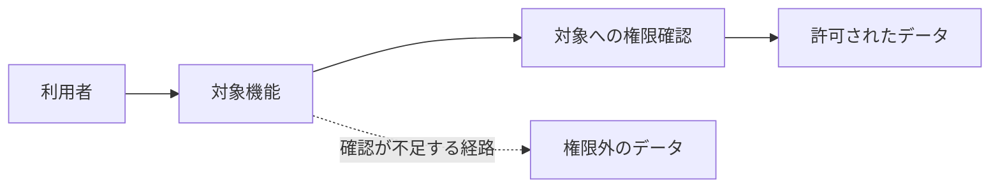

# Issue 本文の書式

日本語で、対象機能を初めて読む人にも前提と判断理由が分かるように書く。以下の欄を実際の調査結果に置き換え、該当しない欄はその理由を示す。図のラベルは短くし、コードや Issue 本文から取り出した文字列をそのまま Mermaid の構文に埋め込まない。

## 個別 Issue

タイトルは `[high] 別組織のデータを取得できる` のように、`severity.impact.score` をそのまま接頭辞に使い、問題を具体的に書く。`fingerprint-alias` は必要な数だけ行を作り、未登録なら省く。確認できない `completed-at` も省く。

````markdown
<!-- security-audit:begin -->
<!-- security-audit:fingerprint=<最初に登録した fingerprint> -->
<!-- security-audit:fingerprint-alias=<同じ根本原因の別 fingerprint> -->
<!-- security-audit:source-sha=<監査対象の完全なコミット SHA> -->
<!-- security-audit:completed-at=<確認済みの報告確定日時（オフセット付き ISO 8601）> -->
## 対象機能と守るべきルール

機能の目的、利用者と対象データの関係、本来必要な権限確認を説明する。

## 問題と影響

誰が、どの条件で、どの権限の境界を越え、何をできてしまうかを説明する。
タイトルの影響評価と Cloudflare の総合深刻度を示し、確認した影響と成立条件を根拠に説明する。

## 処理の流れと根本原因

正常な経路と問題の経路を文章と図で説明する。次の図は実際の機能に合わせて書き換える。



## コード上の根拠

監査対象コミットに固定したコードリンクと、各箇所が問題にどう関係するかを書く。
独立検証で確認した事実と、検証に使ったダミーデータなどの前提を説明する。

## 修正方針

守るべき条件をどこで強制するか、最小限の修正方針を書く。

## 修正完了条件

- 許可される操作と拒否される操作を確認できること。
- 問題の経路を対象にした回帰テストなどで修正を確認できること。
<!-- security-audit:end -->
````

## 集約 Issue

タイトルは `[yyyy-mm-dd] セキュリティ監査の調査・判定一覧` とし、実行時に記録したタイムゾーンの日付を使う。日時・版番号・反映結果は [集約 Issue の手順](issue-sync.md#6-集約-issue-に反映する) に従う。

各区分（確定・要検証・未検証・棄却）と未完了の工程・範囲は、何が何件あるかを眺める一覧表と、項目ごとの詳細の2段で書く。一覧表には短い語句だけを書き、文章・コードリンク・ID は詳細に書く。一覧表の列と詳細の箇条は下の書式のとおりにする。

### 項目と番号

- 同じ根本原因の項目を1項目にまとめる。ID は fingerprint とし、未割り当ての候補には元スキルの台帳と対応する安定した項目 ID を付ける。
- 各項目に、この集約 Issue の中で一意の番号 `A01`・`A02`…（100件目からは `A100`）を振る。初めて振るときは、確定・要検証・未検証・棄却の順に、確定は影響評価の高い順、ほかは領域ごとにまとめて連番を振る。
- 番号は区分を移っても変えない。同じ実行の再開では、既存の集約 Issue（なければ端末に保存した集約本文）の詳細にある番号と ID の対応を引き継ぎ、新しい項目には最大の番号の次を振る（欠番は詰めない）。未割り当ての候補に fingerprint が付いたら、台帳の対応で同じ番号を付け替える。項目をまとめたときは小さい番号を残して ID の箇条の末尾に `（統合: A07）` のように書き、分けたときは元の番号を片方に残す。
- 区分が変わらない項目の題名と領域は、引き継いだ本文から変えない。

### 一覧表

- 題名は元スキルの `title` をもとに、日本語で30字以内を目安に書く。確定は断定し、要検証・未検証は「〜できる可能性」のように「可能性」で終えて仮説であることを示し、棄却は「〜の疑い」とする。一覧表と `<summary>` には同じ題名を書く。
- 領域は対象リポジトリの機能・構成要素の名前とし、1つの実行の中では同じ領域に同じ語を使う。
- 題名と領域は、記号やコードの識別子を含まない日本語で書く（`<summary>` の中と表のセルでは記号の解釈が違い、表示がそろわないため）。識別子は詳細に書く。
- 確定は影響評価の高い順、同じなら番号順に並べる。ほかの区分は領域ごとにまとめ、領域どうしはその領域の最小の番号の順、領域の中は番号順にする。詳細も一覧表と同じ順にする。
- 確定の「個別 Issue」は URL の確認が済んだものだけをリンクにし、反映を保留した行には `候補: <URL>`（複数なら並べる）か `未作成` と書く。「影響評価」は `severity.impact.score` の値、「反映結果」は `作成`・`更新`・`変更なし`・`保留` のどれかだけにし、理由とラベルの結果は詳細に書く。
- 要検証の「判定に必要な確認」には、確定か棄却かを判定するために要る確認を次から1つ以上選び、`、` でつないで書く。`validation_plan.local` があれば `ローカル検証`、`validation_plan.deployment` があれば `環境・権限の確認` を含め、ほかは `blockers` から判断する。
  - `仕様確認`: 所有者が意図した挙動を決めれば判定できる。
  - `ローカル検証`: ダミーデータや隔離環境での実行で確かめる。
  - `環境・権限の確認`: デプロイ先の設定や、外部サービス・IAM の権限を確かめる。
  - `その他`: プロファイル・範囲・予算の変更など、上のどれにも当たらない。内容は詳細に書く。
- 未検証の「停止した工程」は元スキルの工程名だけにし、理由は詳細に書く。

### 詳細

- 1項目を1つの `<details>` にし、`<summary>` には `<b>番号</b> 題名` だけを書く。`<summary>` の行のあとと `</details>` の前に空行を入れる（入れないと中の箇条書きが表示されない）。
- 各箇条は1〜2文を目安にする。要検証と未検証が仮説であることは題名の「可能性」と箇条の見出し（「想定される影響」など）で示すので、箇条の文末に「可能性」を重ねず「〜を確保できる。」「〜を圧迫する。」のように書く。確認していない影響は「主張しない範囲」に分けて書く。深刻度の確定評価は個別 Issue に書く。
- 根拠のコードは監査対象 SHA で固定してリンクし、リンク文字はリポジトリ相対パスと行（`path:40`）にする。同じファイルの続いた行は `path:40-41`（URL は `#L40-L41`）にまとめる。冒頭と異なる SHA・日時の根拠は、その箇条に明記する。詳細の文章に書く識別子・パス・パッケージ名はコード表記にする。
- ID は fingerprint（未割り当ては項目 ID）をコード表記で書く。

### 件数

冒頭と各見出しに件数を書き、一覧表の行数・詳細の数と一致させる。0件の区分は見出しの下に `0件。` とだけ書き、表を作らない。件数を確かめられない区分は見出しを `（不明・確認できた分 <件数>件）` にし、理由を1行書いたうえで、確認できた項目は一覧表と詳細に載せる。

### 未完了の工程・範囲

- 調査を終えられなかった工程・監査範囲と、どの確定項目にも属さない Issue 反映の保留（集約 Issue のラベル、登録先の権限不足など）を項目にする。停止した工程・停止の理由・再開条件が同じ範囲は1項目にまとめ、ID の箇条に監査単位 ID を並べる。未検証の項目と、確定の詳細に書いた反映結果は再掲しない。
- 番号は `U01`・`U02`… とし、本文を書くたびに一覧表の順に振り直す。並び順は停止した工程ごとにまとめ、元スキルの工程順にする。
- 見出しの下に、何件がどの工程で止まっているか、監査全体として何が言えないか（台帳の集計など）を1〜2文で書いてから一覧表を置く。件数は分類の区分と同じく見出しに書き、0件なら `0件。` とだけ書く。
- 「範囲」は記号やコードの識別子を含まない日本語の短い語句にする。「停止した工程」は元スキルの工程名か `Issue 反映`、「再開に必要なもの」は要検証の「判定に必要な確認」と同じ語から1つ以上を選んで `、` でつなぐ。
- 詳細の「調査の入口」「関連する項目」「対象 Issue」「ID」は、該当するものがなければ省く。対象 Issue には URL をそのまま書き、ID には監査単位 ID をコード表記で書く。

````markdown
<!-- security-audit:summary-begin -->
<!-- security-audit:summary-id=<実行固有の audit_id> -->
<!-- security-audit:summary-revision=<保存した版番号> -->
<!-- security-audit:source-sha=<監査対象の完全なコミット SHA> -->
監査対象のリポジトリ・コミット、プロファイル、監査範囲を書く。
監査の完了状況、Issue 反映の状況、実行のタイムゾーンとオフセット付き報告確定日時、タイトルの日付の出所を書く。
確定・要検証・未検証・棄却の件数を示す。

## 確定（<件数>件）

| No. | 個別 Issue | 影響評価 | 題名 | 反映結果 |
| --- | --- | --- | --- | --- |
| A01 | 個別 Issue の URL | high | 断定の題名 | 作成 |

<details><summary><b>A01</b> 断定の題名</summary>

- **概要**: 前提と確認した影響。
- **反映結果**: 作成・更新・変更なし・保留の理由、ラベルの結果、残る対応。
- **ID**: `<fingerprint>`

</details>

## 要検証（<件数>件）

| No. | 題名 | 領域 | 判定に必要な確認 |
| --- | --- | --- | --- |
| A02 | 〜できる可能性 | 機能・構成要素の名前 | 仕様確認、ローカル検証 |

<details><summary><b>A02</b> 〜できる可能性</summary>

- **想定される影響**: 誰が何をできるか。
- **確認済みの根拠**: コミット固定のコードリンクと確認結果。
- **不足している事実**: 判定を左右する設定や挙動。
- **次に調べること**: 確認箇所、方法、判断できる結果。
- **主張しない範囲**: 確認していない影響。なければ省く。
- **ID**: `<fingerprint>`

</details>

## 未検証（<件数>件）

| No. | 題名 | 領域 | 停止した工程 |
| --- | --- | --- | --- |
| A03 | 〜できる可能性 | 機能・構成要素の名前 | 元スキルの工程名 |

<details><summary><b>A03</b> 〜できる可能性</summary>

- **候補の概要**: 調査の出発点となった内容。
- **調査済みの範囲と根拠**: 読んだコードのリンクと確認済みの事実。
- **停止の理由**: 独立検証で Daybreak が案内された、など。
- **残作業と再開条件**: 必要な権限や環境、次に確かめる事実。
- **主張しない範囲**: 確認していない影響。なければ省く。
- **ID**: `<項目 ID>`

</details>

## 棄却（<件数>件）

| No. | 題名 | 領域 |
| --- | --- | --- |
| A04 | 〜の疑い | 機能・構成要素の名前 |

<details><summary><b>A04</b> 〜の疑い</summary>

- **疑った問題**: 元の仮説。
- **棄却の根拠**: 仮説を否定した制御や挙動とコードリンク。
- **再調査が必要になる条件**: 根拠のコードや成立条件が変わる場合、など。
- **ID**: `<fingerprint>`

</details>

## 未完了の工程・範囲（<件数>件）

全体の状況を1〜2文で書く。

| No. | 範囲 | 停止した工程 | 再開に必要なもの |
| --- | --- | --- | --- |
| U01 | 範囲の短い語句 | 元スキルの工程名 | 環境・権限の確認 |

<details><summary><b>U01</b> 範囲の短い語句</summary>

- **未確認の事項**: 確かめられていない事実や設定。
- **停止の理由**: 成果物の不足、権限・環境の不足など。
- **再開条件**: 誰が何を用意・確認すれば再開できるか。
- **調査の入口**: 監査対象 SHA で固定したコードリンク。
- **関連する項目**: A05、A17 など、この範囲に判定が左右される項目の番号。
- **対象 Issue**: 反映を保留した Issue の URL。
- **ID**: `<監査単位 ID>`

</details>

## 調査の補足

複数の項目にまたがる前提や権限の境界を、項目を番号で指して説明する。
必要に応じて図を添える。
<!-- security-audit:summary-end -->
````
