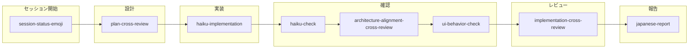

# agent-skills

Claude Code と Codex 向けの、特定のプロジェクトに依存しない汎用スキル集。\
導入すると、Claude Code に普段どおり頼むだけで、次のように作業が進む。

- 設計と差分を、GPT-6.2 Astra と Fable 5.2 がレビューする。
- 実装と、テスト・lint などの確認を、Haiku 5.5 が受け持つ。
- Claude が結果を自然な日本語で報告する。

作業ごとに、次のエージェントのスキルを使う。

| 作業 | Claude Code | Codex |
| --- | --- | --- |
| [開発](#自動で使われるスキル) | 設計・実装・確認・レビュー・報告 | — |
| [整備（リファクタリング）](#リファクタリング用スキル) | 振る舞いを変えずにコード・テスト・文書を整える | — |
| [GitHub の対応・Web の調査など](#指定して使うスキル) | Issue / PR の一覧と自動対応、Web の調査、このスキル集の更新 | — |
| [依存の更新](#codex-用スキル一覧) | — | ランタイムと依存を更新する |
| [開発以外](#開発以外のスキル) | — | ファイルを内容から改名する |

Claude は作業の一部を次のサブエージェントや Codex CLI に任せ、指示・採否・反映を受け持つ。

| 任せる先 | 任せること | スキル |
| --- | --- | --- |
| Haiku 5.5 | 実装と、テスト・lint・CI ログなどの確認 | haiku-implementation・haiku-check |
| GPT-6.2 Astra（Codex CLI）と Fable 5.2 | 設計と差分のレビュー | plan-cross-review・implementation-cross-review |
| GPT-6.2 Sol（Codex CLI）と Opus 5.5 | 差分が既存の設計に沿っているかの確認 | architecture-alignment-cross-review |

Claude Code は Opus 5.5 の推論レベル high で動かすことを推奨する。

## はじめに

1. メインの checkout の直下でリンクする。

   ```bash
   scripts/link-skills.sh
   ```

   Claude Code 用は `~/.claude/skills/`・`~/.claude/agents/`、Codex 用は `~/.agents/skills/` にリンクされる。\
   スキルの追加・改名・削除のあとも再実行し、反映されなければ新しいセッションを始めるか Codex を再起動する。\
   導入したあとは、Claude Code から skills-update を呼べば、取り込み・リンク・確認を 1 回で済ませられる。

   <details>
   <summary>リンクの細かい動き</summary>

   - git worktree からは実行できない。
   - `CLAUDE_CONFIG_DIR` があれば、Claude Code 用はその配下にリンクする。
   - `--claude` / `--codex` で片方だけにできる。
   - 既存の同名ファイルや、別の場所への有効なリンクは上書きしない。

   </details>

2. skills-preflight（[Claude Code](.claude/skills/skills-preflight/SKILL.md)・[Codex](.agents/skills/skills-preflight/SKILL.md)）で、必要なコマンド・ログイン・リンクを確かめる（Claude Code では足りないコマンドとリンクを了承を得てから入れる）。\
   自動で使われるクロスレビューと、Haiku への実装の委任には、次の前提が要る（細かい条件は各 SKILL.md にある）。

   | 前提 | 使うスキル |
   | --- | --- |
   | `perl` | plan-cross-review・haiku-implementation・architecture-alignment-cross-review・implementation-cross-review・codebase-cleanup-workflow・gh-issue-autofix |
   | `jq` | haiku-implementation・gh-issue-autofix、クロスレビューの Codex の担当（architecture-alignment-cross-review の Sol を含む） |
   | `codex` のログイン | クロスレビューの Codex の担当（architecture-alignment-cross-review の Sol を含む） |
   | メインが auto モード | haiku-implementation、codebase-cleanup-workflow（ないときは Haiku に実装を任せない） |

   ほかの前提は、次のスキルや場面でだけ要る（自動で使われるスキルの分も含む）。

   <details>
   <summary>スキルや場面ごとの前提</summary>

   | 前提 | 使うスキル |
   | --- | --- |
   | `gh` のログイン | gh-todo・gh-issue-autofix、haiku-check で CI のログを見るとき |
   | Claude デスクトップアプリ | session-status-emoji |
   | 組み込みブラウザか Claude in Chrome | browser-readonly-research |
   | 組み込みブラウザ | ui-behavior-check・gh-issue-autofix（ないときは動作確認を未検証にする） |
   | 権限の確認が出ない権限モード（auto モードなど） | gh-issue-autofix（無人で動かすとき） |
   | Python 3.9 以降 | Codex の minor-version-upgrade・rename-files-by-content |
   | 対象が git リポジトリで、未コミットの変更がない | codebase-cleanup-workflow |

   </details>

## Claude Code 用スキル一覧

`/スキル名` で指定して使う。\
自動で使われるスキルも、指定や話しかけで使える。

### 自動で使われるスキル

条件に当たると、頼まれなくても使う。\
作業の流れのどこで使うかは次のとおり。



| スキル | できること | 使う場面 |
| --- | --- | --- |
| [session-status-emoji](.claude/skills/session-status-emoji/SKILL.md) | セッション名に作業の段階の絵文字を付ける | デスクトップアプリの全セッション |
| [plan-cross-review](.claude/skills/plan-cross-review/SKILL.md) | 設計を Astra と Fable にレビューさせる | 設計・実装計画を示す前 |
| [haiku-implementation](.claude/skills/haiku-implementation/SKILL.md) | 実装を Haiku 5.5 に任せ、手分けして進める | 指示書に書けて確かめられる実装 |
| [haiku-check](.claude/skills/haiku-check/SKILL.md) | テスト・lint・CI ログの確認を Haiku 5.5 に任せる | 状態を変えない確認 |
| [architecture-alignment-cross-review](.claude/skills/architecture-alignment-cross-review/SKILL.md) | 差分が既存の設計に沿っているかを Sol と Opus に確かめさせて直す | 構造を選ぶ実装のテストの後 |
| [ui-behavior-check](.claude/skills/ui-behavior-check/SKILL.md) | 開発サーバーを起動し、画面を操作して動作を確かめる | Web の画面に出る変更の後 |
| [implementation-cross-review](.claude/skills/implementation-cross-review/SKILL.md) | 差分を Astra と Fable にレビューさせて直す | 完了報告・コミット・PR の前 |
| [japanese-report](.claude/skills/japanese-report/SKILL.md) | 報告を自然な日本語で書く | 結果を報告する前 |

### リファクタリング用スキル

指定したときだけ使い、振る舞いを変えずにコード・テスト・文書を整える。

| 工程 | スキル | できること |
| --- | --- | --- |
| 1〜6 | [codebase-cleanup-workflow](.claude/skills/codebase-cleanup-workflow/SKILL.md) | 下の 6 本を順に使い、工程ごとに Haiku の確認と Astra・Fable のレビューを挟んで作業ブランチにコミットする |
| 1 | [architecture-alignment-refactor](.claude/skills/architecture-alignment-refactor/SKILL.md) | 設計方針から外れた責務分担や依存関係を直す |
| 2 | [overengineering-refactor](.claude/skills/overengineering-refactor/SKILL.md) | 過剰な抽象化・汎用化・防御的実装や未使用コードを取り除く |
| 3 | [code-structure-refactor](.claude/skills/code-structure-refactor/SKILL.md) | 責務の混在や重複を、分割・共通化で直す |
| 4 | [test-suite-refactor](.claude/skills/test-suite-refactor/SKILL.md) | 検出力を保ったまま、テストの重複を整理する |
| 5 | [code-order-refactor](.claude/skills/code-order-refactor/SKILL.md) | メソッドや関数を読みやすい順に並べ替える |
| 6 | [docs-align-with-code](.claude/skills/docs-align-with-code/SKILL.md) | 実装に合わせて文書を更新する |

### 指定して使うスキル

次の作業の提案、GitHub の Issue / PR の対応、Web での調査、このスキル集の更新など、必要なときに呼ぶ。

| スキル | できること |
| --- | --- |
| [whats-next](.claude/skills/whats-next/SKILL.md) | 進捗と次のアクションを 1 つ示し、承認後に進める |
| [gh-todo](.claude/skills/gh-todo/SKILL.md) | レビュー依頼・メンション・自分の Issue / PR を一覧にする |
| [gh-issue-autofix](.claude/skills/gh-issue-autofix/SKILL.md) | `agent:autofix` ラベルの Issue を 1 件、質問せずに対応し、同じラベルのドラフト PR にする |
| [browser-readonly-research](.claude/skills/browser-readonly-research/SKILL.md) | Web ページを読むだけで調べてまとめる |
| [skills-update](.claude/skills/skills-update/SKILL.md) | このスキル集を最新に取り込み、Claude Code・Codex へリンクし直して、使えるスキルを確かめる |

## Codex 用スキル一覧

すべて `$スキル名` で指定したときだけ使う。

| スキル | できること |
| --- | --- |
| [minor-version-upgrade](.agents/skills/minor-version-upgrade/SKILL.md) | ランタイムと依存を、互換性を保つ範囲で更新する |

## 開発以外のスキル

Codex 用は `$スキル名` で指定したときだけ使う。

| スキル | エージェント | できること |
| --- | --- | --- |
| [rename-files-by-content](.agents/skills/rename-files-by-content/SKILL.md) | Codex | ファイルを内容から `YYYY-MM-DD_名前` に改名する |

## 関連リポジトリ

| リポジトリ | 内容 |
| --- | --- |
| [security-audit-workflow](https://github.com/nir-nmttg/security-audit-workflow) | Cloudflare の security-audit で監査し、結果を GitHub の Issue にまとめて調べ直す、Claude Code・Codex 向けのスキル集（`agent:autofix` が付いた修正 Issue は gh-issue-autofix で対応できる） |
| [README.md を長期記憶にする AGENTS.md](https://gist.github.com/nir-nmttg/84d8e13fa9904cbfe56d05b1a7e90970) | 各ディレクトリの README.md を、設計判断・注意点・責務境界を蓄える長期記憶として、AI に作業前に読ませ、作業後に更新させる AGENTS.md の例 |

## スキルの追加・変更

作り方と変更時の確認は [AGENTS.md](AGENTS.md) にある。\
スキルの作業用ファイルは、このリポジトリの `artifacts/<スキル名>/`（gitignore 済み）に置く。

## ライセンス

[MIT License](LICENSE)
